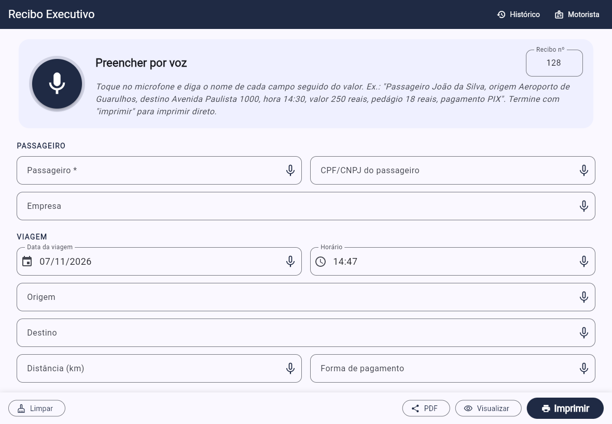

# Recibo Executivo

Aplicativo para tablet (iOS e Android) que emite **recibos A4 de transporte executivo de passageiro**.
O motorista preenche os dados **por voz** e imprime o recibo numa **impressora portátil Bluetooth**.



Exemplo de recibo gerado: [docs/recibo_exemplo.pdf](docs/recibo_exemplo.pdf)

## Funções

- **Ditado completo**: toque no microfone grande e fale todos os dados numa frase só.
- **Microfone em cada campo**: corrija só um campo falando de novo.
- **Recibo A4** com:
  - cabeçalho do motorista;
  - número do recibo;
  - valor total e valor por extenso;
  - dados da viagem;
  - lista de valores (corrida, pedágio, estacionamento, espera);
  - forma de pagamento, chave PIX e veículo;
  - local, data e linha de assinatura.
- **Impressão** pelo sistema: AirPrint no iOS e serviço de impressão no Android.
- **PDF para compartilhar** por WhatsApp ou e-mail.
- **Histórico**: busca, segunda via, "repetir viagem" e total do período.
- **Numeração automática** dos recibos.
- Os dados ficam só no aparelho. O app não usa servidor.

## Como ditar

Fale o **nome do campo** e depois o valor. A ordem não importa. Você pode falar com ou sem pausas.

> "Passageiro João da Silva, CPF 123 456 789 09, empresa Acme, origem Aeroporto de Guarulhos
> terminal 3, destino Avenida Paulista 1000, data hoje, hora 14:30, distância 38 km,
> valor 280 reais, pedágio 18 reais e 40 centavos, estacionamento 25 reais,
> pagamento PIX, observação voo LA 3341. Imprimir."

| Campo | Palavras que você pode falar |
|---|---|
| Passageiro | passageiro, passageira, cliente, nome |
| CPF/CNPJ | CPF, CNPJ, documento |
| Empresa | empresa, nome da empresa, companhia |
| Data | data, data da viagem: "hoje", "ontem", "5 de novembro", "05/11" |
| Horário | hora, horário, hora de embarque: "14:30", "duas e meia da tarde" |
| Origem | origem, embarque, local de embarque, saída, partida |
| Destino | destino, desembarque, chegada |
| Distância | distância, quilometragem, km |
| Valor | valor, valor da corrida, valor total, preço, total |
| Pedágio | pedágio |
| Estacionamento | estacionamento |
| Outras despesas | espera, tempo de espera, hora parada, adicional, outras despesas |
| Pagamento | pagamento, forma de pagamento, pago com: PIX, dinheiro, cartão de crédito... |
| Observações | observação, obs |

- Fale os valores em algarismos ("250 reais") ou por extenso ("duzentos e cinquenta reais").
- Diga **"imprimir"** no fim para imprimir logo depois do ditado.
- Cada campo começa na **primeira** vez que você fala o nome dele. Exemplo: em "observação cliente
  com 2 malas", a palavra "cliente" fica no texto da observação. Para corrigir um campo, use o
  microfone desse campo.

## Impressora Bluetooth A4

Impressoras **térmicas de bobina** (58 mm ou 80 mm) não imprimem A4. Use uma impressora portátil A4.
Exemplos de modelos para conferir: HP OfficeJet 200/250 Mobile, Canon PIXMA TR150,
Epson WorkForce WF-110 e Brother PocketJet (PJ-773, PJ-883).

**Android**

1. Pareie a impressora nas configurações de Bluetooth.
2. Na Play Store, instale o plug-in de impressão do fabricante: Brother Print Service Plugin,
   HP Print Service Plugin, Canon Print Service, Epson Print Enabler ou Mopria Print Service.
   Confira se o plug-in aceita Bluetooth para o seu modelo. Se não aceitar, use o Wi-Fi Direct da
   impressora.
3. No app, toque em **Imprimir** e escolha a impressora e o papel A4.

**iOS / iPadOS**

O iPad só imprime pelo sistema por **AirPrint**, e o AirPrint usa Wi-Fi, não Bluetooth.
Para isso, escolha uma impressora portátil com **Wi-Fi Direct + AirPrint**. Ela cria a própria
rede Wi-Fi e não precisa de internet. Conecte o iPad nessa rede uma vez. Depois, em
**Motorista → Recibos e impressão → Escolher**, defina a impressora padrão. Então o botão
Imprimir envia direto, sem abrir a caixa de diálogo.

Algumas impressoras só funcionam por Bluetooth no iOS, como a linha Brother PocketJet MFi. Elas
exigem o SDK do fabricante, e este projeto ainda não tem essa integração. Para usar o mesmo
modelo no iPad e no Android, a melhor escolha é uma impressora com **Bluetooth + Wi-Fi Direct +
AirPrint + Mopria**.

> Confira se o modelo da impressora funciona com o seu sistema antes de comprar. O app usa o
> sistema de impressão padrão do iOS e do Android. Assim, toda impressora que o tablet reconhece
> também funciona no app.

## Compilar e instalar

Requisitos: [Flutter](https://docs.flutter.dev/get-started/install) 3.24 ou mais novo.
Para Android, instale o Android Studio. Para iOS, use um Mac com Xcode.

```bash
flutter pub get
flutter test                       # testes da interpretação de voz, extenso e tela
flutter run                        # com o tablet conectado por cabo

flutter build apk --release        # Android: build/app/outputs/flutter-apk/app-release.apk
flutter build ipa --release        # iOS: depois envie pelo Xcode / TestFlight
```

Para gerar um recibo de exemplo sem tablet, use: `dart run tool/gerar_exemplo.dart exemplo.pdf`.

O projeto já tem estas permissões:

- Android (`android/app/src/main/AndroidManifest.xml`): microfone, consulta ao serviço de
  reconhecimento de voz (Android 11+) e Bluetooth.
- iOS (`ios/Runner/Info.plist`): microfone, reconhecimento de fala, Bluetooth e rede local
  (AirPrint).

## Estrutura

```
lib/
  core/            lógica pura em Dart (com testes)
    ditado.dart          divide o ditado nos campos do recibo
    interpretadores.dart lê valores, datas, horas, CPF/CNPJ e pagamento falados
    extenso.dart         valor por extenso ("duzentos e cinquenta reais")
    formatadores.dart    moeda, datas e documentos no padrão brasileiro
  models/modelos.dart    Motorista e Recibo
  services/
    recibo_pdf.dart      layout A4 do recibo
    impressao.dart       impressão (AirPrint / Android) e compartilhamento
    voz.dart             reconhecimento de voz em pt-BR
    armazenamento.dart   dados do motorista, numeração e histórico
  screens/               telas: recibo, pré-visualização, motorista, histórico
  widgets/campo_voz.dart campo com microfone e botão de ditado
```

## Observações

- O reconhecimento de voz usa o serviço do sistema (Apple ou Google). No Android, ele pode
  precisar de internet. Para usar sem internet, baixe o pacote de voz "Português (Brasil)" nas
  configurações do Google.
- Este recibo comprova o pagamento, mas não substitui a nota fiscal de serviço (NFS-e). Isso vale
  quando o cliente ou a empresa pede nota fiscal.
